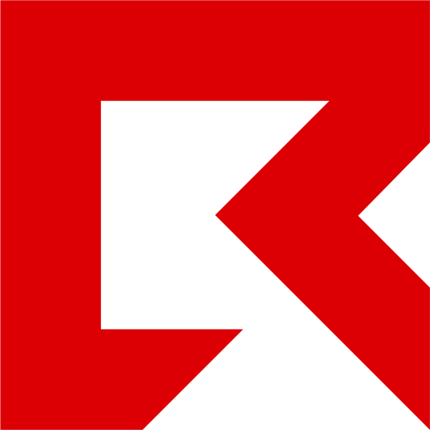

# Romulus

### Distribution done right.

**Growth accelerator** for manufacturers and their distribution partners.

---

## What Romulus does

Romulus brings manufacturers and distributors onto one platform, from the first partner invitation to the last invoice.

| Feature | What it does |
|---|---|
| 🤝 **Partner onboarding** | Invite distributors and manage each partnership in one place. |
| 📦 **Product catalogue** | Share products, pricing and documents with your partners. |
| 🧾 **Quotes, orders and invoices** | Run the full sales cycle, from the quote to the paid invoice. |
| ♻️ **Circular inventory** | Track stock that moves back through the network. |
| 🎓 **Training and sales tools** | Give partners the material and the knowledge they need to sell. |
| 🎯 **Missions and broadcasts** | Set goals for partners and send updates to the whole network. |
| 📊 **Dashboards** | See the performance of your distribution network at a glance. |

## Built with

## Security

- Dependabot and Snyk check our dependencies
- Found a vulnerability? Read our [security policy](https://github.com/romulus-io/.github/blob/main/SECURITY.md) and email **compliance@romulus.io**

---

© Romulus Technologies FZCO

